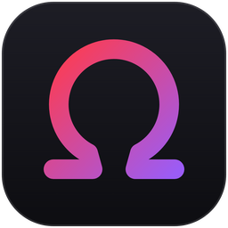
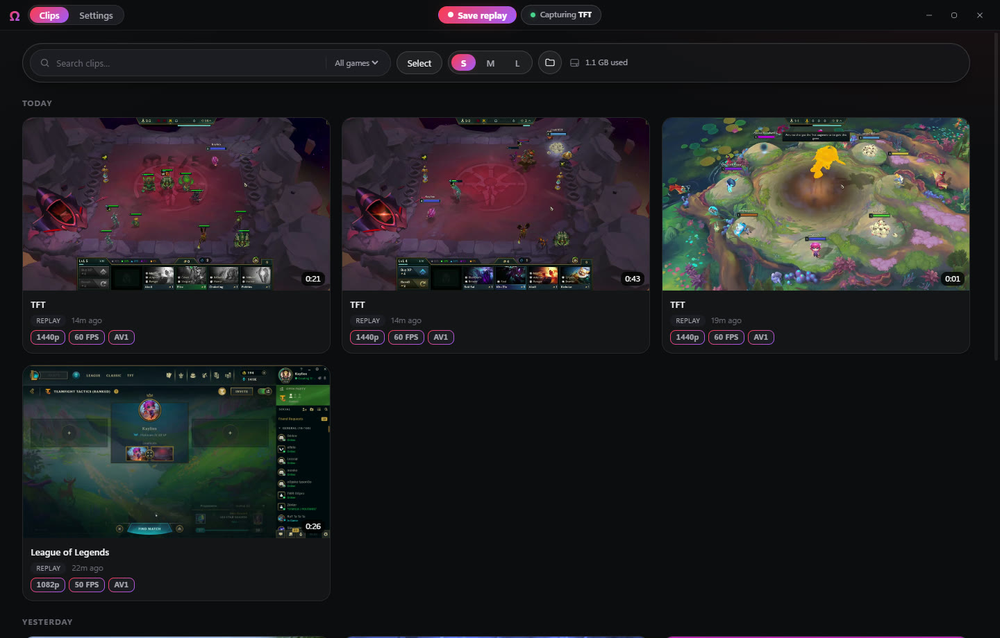
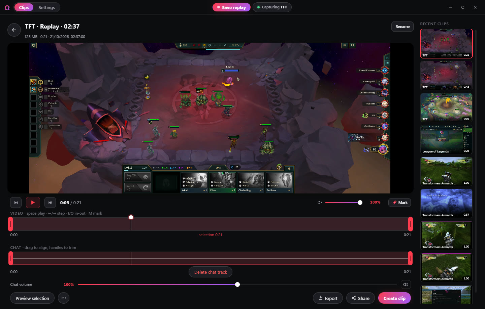
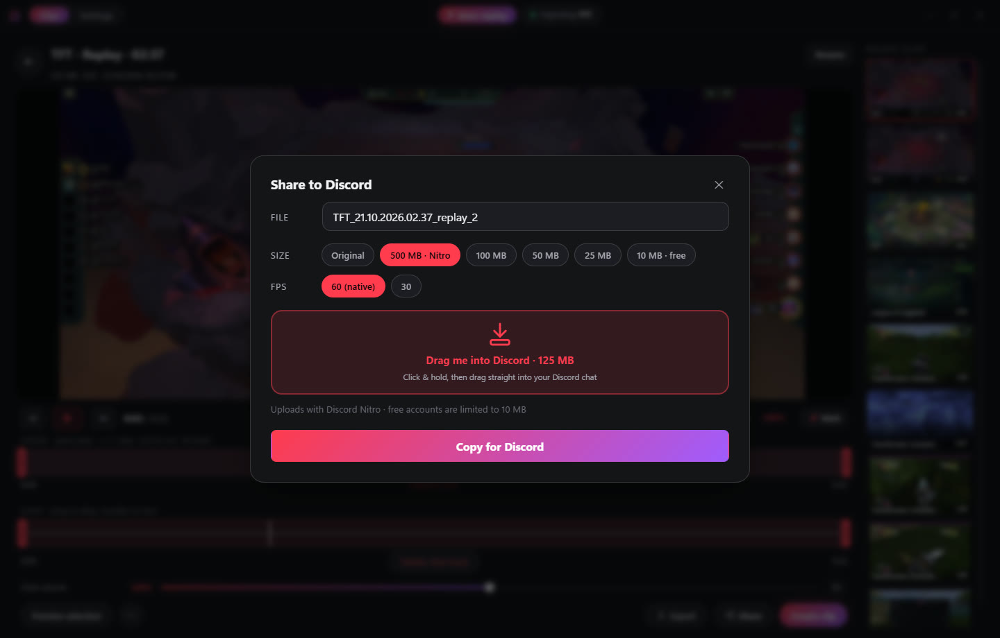
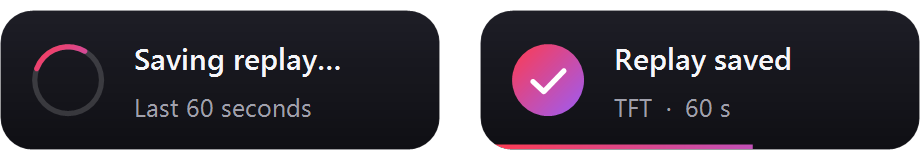
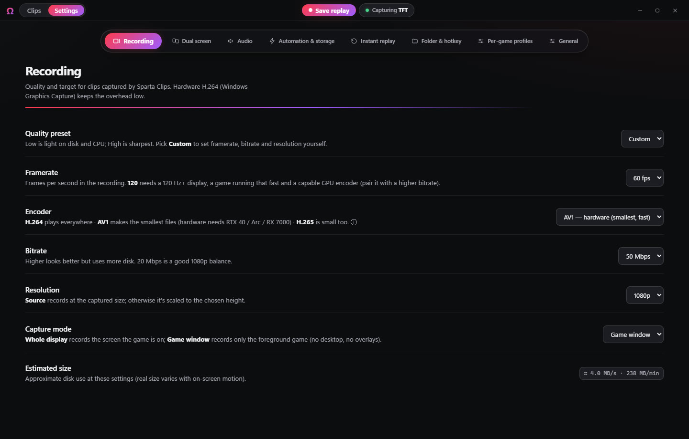

<div align="center">



# Sparta Clips

**Save your best gaming moments with one key press.**<br>
A free, lightweight clip recorder for Windows that sits quietly in your tray & then lets you trim
your clip and drop it straight into Discord.

<br>

<a href="https://github.com/kayliox/sparta-clips/releases/latest/download/SpartaClipsSetup.exe">
  
</a>

<sub>Windows 10 &amp; 11 (64-bit) · about 55 MB · nothing else to install · <a href="https://github.com/kayliox/sparta-clips/releases">all versions</a></sub>

<br><br>

[](https://github.com/kayliox/sparta-clips/releases/latest)
[](https://github.com/kayliox/sparta-clips/releases)
[](https://github.com/kayliox/sparta-clips/actions/workflows/release.yml)
[](LICENSE)

<br>



</div>

---

## ✨ What it does

|  |  |
|---|---|
| ⏪ **Instant replay** | Something awesome just happened? Press **Ctrl + Alt + F10** and the last 30 seconds are saved. No need to be recording beforehand. |
| 🎬 **Record anything** | Press **Ctrl + Alt + F9** to start and stop a full recording. |
| 🔊 **Sound that just works** | Records your game's audio at full volume, even if your headset software turns it down, plus your mic and Discord voice on their own tracks if you want them. |
| ✂️ **Easy editing** | Trim the boring bits, mute a track, mark the highlights. No video skills needed. |
| 💬 **One-drag Discord sharing** | Pick a size (10 MB free, up to 500 MB with Nitro), then drag the clip straight into a Discord chat. Smaller sizes are automatically optimised so they still look sharp. |
| 🪶 **Featherweight** | Lives in the system tray with no window open, so your games keep their frame rate. |
| 🎯 **Knows what you're playing** | Follows the game you're in, or click **Capturing …** to lock it to one game. |

<div align="center">


</div>

---

## 📥 How to install (2 minutes)

1. **Click the big download button** above. Your browser saves `SpartaClipsSetup.exe` — usually to your *Downloads* folder.
2. **Double-click `SpartaClipsSetup.exe`.**
   > **Seeing a blue "Windows protected your PC" box?** That's normal for new free apps that haven't paid
   > for a Microsoft certificate yet. Click **More info**, then **Run anyway**.
3. Tick the options you want, click **Install**, and you're done. Sparta Clips opens by itself.

**No admin password, no extra downloads, no account.** Sparta Clips appears in your Start menu and in the
system tray (bottom-right, near the clock — click the **^** arrow if you don't see it).

## 🎮 How to use it

1. **Play your game** like normal. Sparta Clips is already recording in the background (it only keeps the last
   30 seconds, so it doesn't fill your disk).
2. Something cool happens? Press **Ctrl + Alt + F10**. You'll hear a quick sound and see a small notification in
   the top-left corner, your clip is saved. (The notification never shows up in your recordings.)

   

3. Open Sparta Clips from the tray to **watch, trim, or share** it. To share: click **Share**, then **drag the big
   red box into your Discord chat**, or click **Copy for Discord** and paste with **Ctrl + V**.

<div align="center"></div>

You can change the keys, the replay length, the quality and where clips are saved in **Settings**.

## ❓ Questions

<details>
<summary><b>Where are my clips saved?</b></summary>

In your **Videos** folder, under **Sparta Clips → Clips**. Click the folder button in the app to open it.
You can choose a different folder in Settings.
</details>

<details>
<summary><b>Will it slow down my games?</b></summary>

It's built to stay out of the way: it uses your graphics card's built-in video encoder, and the app window
isn't even running while it sits in the tray. Most people won't notice it at all.
</details>

<details>
<summary><b>How do I update?</b></summary>

You don't have to do anything. When a new version is out, Sparta Clips asks if you want to install it
(never while you're in a game). Click **Install update** and it updates itself and reopens.
You can turn this off, or check by hand, in **Settings → General**.

Running the installer again works too: it updates in place and keeps your clips and settings.
</details>

<details>
<summary><b>How do I uninstall?</b></summary>

Windows **Settings → Apps → Installed apps → Sparta Clips → Uninstall**. Your clips stay in your Videos
folder. They are never deleted.
</details>

<details>
<summary><b>My hotkey doesn't work in one particular game.</b></summary>

Some games with anti-cheat run with extra permissions. In **Settings → General**, turn on
**Start elevated** so the hotkeys work there too.
</details>

<details>
<summary><b>Does it record my Discord voice chat?</b></summary>

Only if you turn on **Capture chat audio** in Settings → Audio. It goes on its own track, so you can mute it
in the editor before sharing.
</details>

<details>
<summary><b>What do I need?</b></summary>

A 64-bit PC with Windows 10 (version 1809 or newer) or Windows 11. Any graphics card works; the smallest
"AV1" files need a recent one (NVIDIA RTX 40, Intel Arc, AMD RX 7000 or newer).
</details>

---

<details>
<summary><h2>🛠️ For developers</h2></summary>

A C# .NET 8 WinForms host wrapping a zero-build WebView2 frontend (`web/`). `CLAUDE.md` documents the
architecture, design invariants and C#↔JS contracts.

### Build / run
```
./deploy.ps1                  # build Release (x64) + stage to SpartaClips-final\, then run it
./installer/build.ps1         # self-contained publish + Inno Setup -> artifacts\SpartaClipsSetup.exe
python tools/make_icon.py     # re-render app.ico + docs/icon.png after editing docs/icon.svg (needs Pillow)
python tools/make_chime.py    # re-synthesize the "clip captured" sound -> Services/Capture/chime.wav (needs numpy)
```
Development builds need the .NET 8 SDK and the WebView2 Runtime (x64 only — ScreenRecorderLib is x64-native).
`SpartaClips.exe --tray` starts hidden to the tray (used by autostart).

**Releases are automatic:** every push to `main` runs [`.github/workflows/release.yml`](.github/workflows/release.yml),
which builds the installer and publishes it as the newest release (`v0.1.<build>`). The download button links to
`releases/latest/download/SpartaClipsSetup.exe`, so it always serves the newest build.

### Tests
```
cd tools\enginetest; dotnet run -c Release      # engine internals vs the built DLL (encoder pick, game audio level,
                                                # share mix/resolution, capture-target filter) — plays a quiet test tone
pip install websocket-client                    # once — the UI/CDP tools below need it
./deploy.ps1 -TestHooks                         # the UI tools drive the app over CDP — only test builds include that hook
python tools\smoke.py                           # UI smoke test · mediatest.py media pipeline · stress.py replay engine
```
Build the app (Release x64, e.g. `./deploy.ps1 -NoLaunch`) before running `enginetest`.

### Layout
```
Program.cs            entry point (single-instance, --tray)
Ui/                   TrayCore, MainForm (+ ClipPlayer/DragShare partials), ClipToast
Bridge/               BridgeApi (+ Capture/ClipPlayer/Share/Config partials) — the JS<->C# surface (clipsBridge)
Services/Capture/     the record/replay/ffmpeg/AV1/sidecar engine
Services/Input/       ClipHotkeyHook
Services/System/      AppConfig, DiagLog, ProcessLoopbackCapture, ManagedTools (slim ffmpeg fetcher)
web/                  the WebView2 UI (index.html, styles.css, app.js) — zero build
installer/            Inno Setup script + local build script
```

### Contributing
Issues and pull requests are welcome. Before opening a PR: build Release with 0 errors, run
`tools\enginetest`, and for UI changes run the smoke test against a `./deploy.ps1 -TestHooks` build.

### Origin
Sparta Clips started as the capture feature of the Sparta Dock launcher and was split out into this standalone,
tray-first app.

### Third-party
- [ScreenRecorderLib](https://github.com/sskodje/ScreenRecorderLib) (MIT) — Windows Graphics Capture + Media Foundation encoding
- [NAudio](https://github.com/naudio/NAudio) (MIT) — WASAPI audio capture
- [Newtonsoft.Json](https://www.newtonsoft.com/json) (MIT)
- [Microsoft Edge WebView2](https://developer.microsoft.com/microsoft-edge/webview2/) — UI host (Microsoft WebView2 license; the installer fetches the runtime only if a PC lacks it)
- [.NET 8](https://dotnet.microsoft.com/) (MIT) — bundled in the installer, so users don't install it separately
- **FFmpeg** is **not bundled**: on first use the app downloads the
  [BtbN FFmpeg build](https://github.com/BtbN/FFmpeg-Builds) (GPL) to `%APPDATA%\SpartaClips\tools` and runs it as a
  separate program for AV1 encoding, previews and shares.

</details>

## License

[MIT](LICENSE) © 2026 Kayliox
